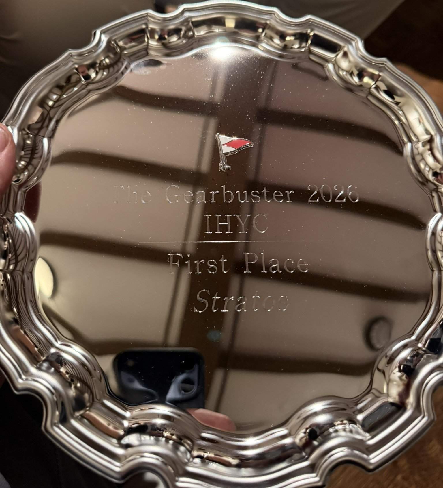
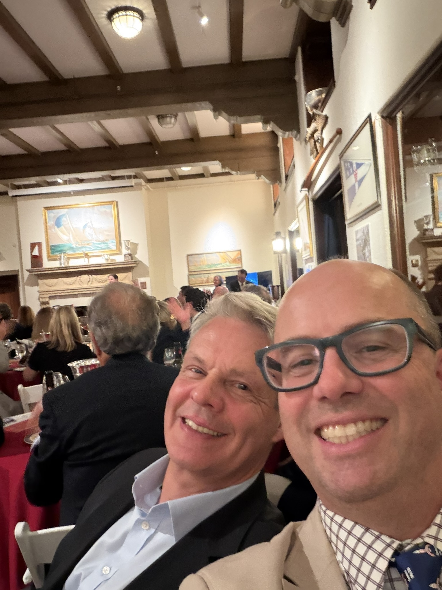

When Steve Fisk arrived at Riverside Yacht Club on race morning, I greeted him with the encouraging news that there was a 50% chance the race would be cancelled. This is, admittedly, an unusual way to build a crew's enthusiasm for the last regatta of the season. Steve took it well.

The forecast called for almost no wind. I had brought both the light-air jib and the windseeker — the latter being our fully battened foresail that holds its shape in conditions too light for a normal jib to care about. The windseeker had made its season debut at the Ida Lewis in August, where rigging it in the middle of the night, parked, was an experience we had no interest in repeating. This time it was ready before we left the dock.

IHYC's race committee had other ideas about cancelling. They started the PHRF Doublehanded fleet on time at 10:05am on a shortened course: out of Captain's Harbor, around a mark off Eaton's Neck, and back. A light northerly had materialized just enough to get seven boats moving, and nobody was arguing.

## To Eaton's Neck

We went with the windseeker from the gun. The Sun Fast 3300's white hull is a beautiful thing when the breeze is up. In 3 knots of pressure with the boat flat, it's about as hydrodynamic as a floating bathtub. The windseeker kept us moving through the lulls, which was the most we could ask.

We positioned ourselves mid-Sound — no thermals developing over either shore, wind oscillating with no readable pattern — and treated the width as optionality. J120 *Hound Dog* (PHRF 42) had a rating advantage on us; J109 *Sunny Side* (PHRF 66) was giving us time and would need to stay close to collect it.

## The Return

Downwind in light air, boat handling beats tactics. We sailed pure VMG, stayed clear of other boats, and let the fleet sort itself out.

The race was decided inside Captain's Harbor.

Before the entrance, *Hound Dog* had pulled ahead and looked borderline uncatchable on elapsed time. Inside the harbor, the wind dropped another notch and we knew we'd be flying the kite all the way to the finish. So that's what we did: hand-steer, work the kite, minimize gybes, and do the layline math in our heads. The winch ratcheted nonstop for the last half hour of the race. It was that kind of finish.

We crossed at 15:33:36 — elapsed 5h 28m 36s. *Hound Dog* had already finished four minutes ahead of us on the water, and *Sunny Side* crossed eight minutes behind.

After PHRF time correction: *Stratos* first at 5:50:09. *Sunny Side* second at 5:55:36. *Hound Dog* third at 5:56:28. Five and a half minutes separated first from third across five and a half hours of racing in dying pressure. Light air giveth and light air taketh away — in this case it gave.

1st of 6, corrected. Last race of the 2026 season.

